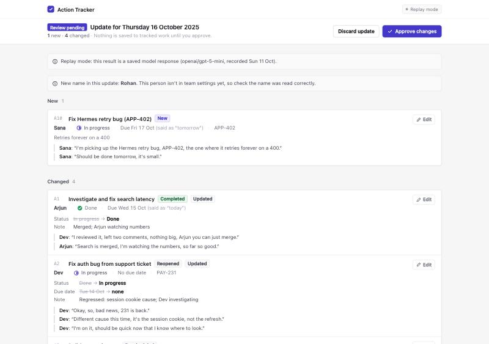
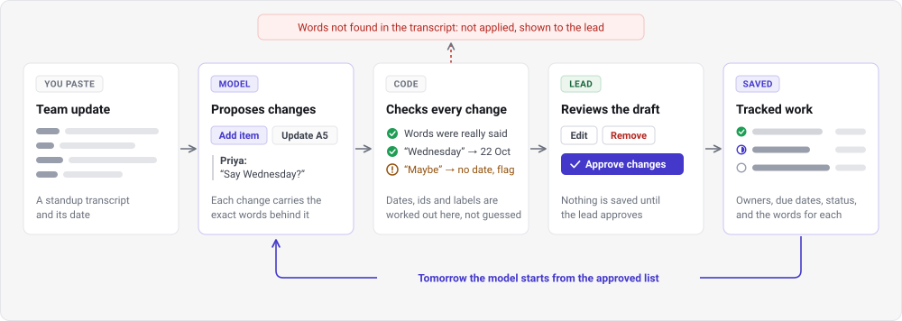

# Standup action tracker

Turns daily standup transcripts into a running list of action items. A model proposes changes, code checks
each one against the transcript, and the lead reviews and approves before anything is saved.



## How it works



- **The model never writes the list.** It returns "add this" or "update A5", each with the words that
  justify it. A repeat mention has to point at an existing item, and "what changed today" is just that list.
- **Code owns everything that can be checked.** Quotes must appear word for word in one speaker turn. Dates
  are worked out by code from the phrase said ("Monday"); the model never does date arithmetic.
- **When the conversation doesn't settle something, the field is left empty and flagged** for the lead, who
  was in the meeting. It does not pick the likeliest answer.
- **The reviewed list carries forward.** The next day's model call sees the approved list, including the
  lead's corrections and removals.

## Run it

Python 3.11 or later.

```bash
python3 -m venv .venv
```

```bash
.venv/bin/pip install -r requirements.txt -e .
```

```bash
.venv/bin/python -m standup_tracker serve
```

Open http://127.0.0.1:8000.

**No API key needed to try it.** With no key the app replays saved model answers for the five standups in
[transcripts/](transcripts/): attach `2025-10-13.txt`, review, approve, then the next day. Any other
transcript is refused with a message saying a key is needed.

**With a key** it reads any transcript live. Copy `.env.example` to `.env` and set `LLM_API_KEY`. The file
ships with OpenRouter's URL and `openai/gpt-5-mini`; any chat-completions endpoint and model can be named
instead. `.env` is git-ignored.

Command line: `python -m standup_tracker run-week transcripts`, plus `process`, `approve`, `discard`, `show`,
`reset`.

## Tests

```bash
.venv/bin/python -m pytest
```

285 pass with no key and no network; 3 more are expected failures (below). Add `-rx` to see them.

## Important choices

| Choice | What it means here | Why |
|---|---|---|
| **Deterministic code, model judgment** | The model interprets the conversation: what is an action, which item it is, who owns it. Code does validation, state transitions, dates, ids and history | Limits silent inconsistencies. The model never does date arithmetic or writes the list |
| **Evidence-backed changes** | The model returns changes ("add", "update A5"), each with exact quotes. Code checks every quote against the original speaker turns before applying it | A repeat mention must point at an existing item, and nothing reaches the list on words that were not said |
| **Human approval** | Proposed changes are a draft until the lead approves. Refused changes are kept and shown with the reason, not dropped | The lead was in the meeting and is the authority; nothing fails silently |
| **Unsure means empty and flagged** | Hedged dates ("maybe tomorrow"), conditions ("if the cert lands") and undecided items go to the lead with the words that were said | A guess that looks confident is worse than a visible gap |
| **Explicit state and lifecycle** | Drafts, approved daily snapshots, removed items and saved model responses are separate things. Dropped (the team cancelled it) is not removed (the lead says it was never an item) | Auditing and reproducible tests: any day can be looked up, and the demo and tests replay recorded answers |
| **Generalisation over memorisation** | The five given transcripts are a practice set that nothing in the prompt or code may name; a test enforces it. New transcripts then bring ambiguous ownership, conditional commitments, near-duplicates and moving deadlines | It has to work on new transcripts, and a system fitted to five days would look better than it is |
| **One generic model interface** | `LLM_BASE_URL`, `LLM_API_KEY`, `LLM_MODEL`; no provider is named in code | Swapping the model is a settings change |

The reasoning, and the decisions that were reversed along the way, are in
[docs/decisions-log.md](docs/decisions-log.md).

## What was verified

| Evidence | Model | Result |
|---|---|---|
| Code tests | None | 246 pass. Includes the answer key run through the real code: the week comes out as expected |
| Practice week, saved answers | One recording, replayed | 39 checks pass; 3 misses by that recording are marked as expected failures |
| Practice week, live ×3 | `openai/gpt-5-mini` | 30 of 30 pieces of work captured, 25 of 30 fully right at week's end |
| **Second week, live ×3** (unseen transcripts) | `openai/gpt-5-mini` | **93 of 126 checks (74%)**, against expectations written before the runs |

Across all live runs:

- **Never happened:** an invented quote (0 of 183 proposed changes), a wrong owner on a scored item.
- **Happened every time on the second week:** a reopened item was never closed again; a date the lead said
  not to promise was kept; an item was added for an alert the lead said not to track.
- **Happened sometimes:** another team's estimate taken as our due date; a returning item added as new (once
  in four practice runs); a small promise skipped.

**Cost and speed** on `openai/gpt-5-mini`: about **1 cent and 24 to 34 seconds per standup**, with no retries
in 30 calls. About 85% of the output tokens, and so most of the cost and the wait, are the model's own
reasoning. The full set of bars for quality, cost and speed, with targets and the levers for trading between
them, is in [docs/scoreboard.md](docs/scoreboard.md).

Details: [practice week](progress/M5-live-repeats.md) ·
[second week](heldout/second-week/results.md) ·
[how the checks were chosen](docs/evaluation-checks.md)

**Not verified:**

- A different team. Both weeks use the same people and systems.
- More than one model, and more than three runs of anything.
- How quickly a lead can check a day. The page was looked at, not timed with a user.
- The scoring is mine. I wrote the prompt, the answer keys and the judging; the second week's expectations
  were reviewed by the owner before the runs, and its transcripts were supplied after the code was built.

## Left out or unfinished

- Login, database, deployment, Linear or Jira integration, audio input (out of scope for now).
- Undo after approval; editing a title or note; merging or splitting items by hand.
- Transcripts not laid out as `Name: words`; languages other than English.
- Nothing was changed in response to the live results. The mistakes above are still there.
- No test with a second team's settings file.

## Next steps

I'd prioritise end-to-end validation over adding features: compare actual outputs with a carefully defined
answer key, fix the highest-impact failures, and test several unseen transcripts. The goal would be to
establish whether the system is reliably useful.

In order:

1. Fix the three mistakes that appeared in every second-week run, as general rules and not as patches for
   those lines.
2. Measure on fresh transcripts, since both weeks are now seen, including a second team.
3. Flag a new item as a possible duplicate when it mentions a ticket number already on the list. That would
   have caught the one duplicate seen.
4. Try lower reasoning effort and a stronger model against the same bars
   ([docs/scoreboard.md](docs/scoreboard.md)).
5. Watch a lead use the review page, and time it.

## Where it could go next

**A confidence score learned from the lead's edits.** The raw material is already recorded: every proposed
change with its quotes and flags, and every correction with the value the system proposed and the value the
lead chose. From that the system could learn where it is usually right (owners were never corrected in our
runs) and where it is not (due dates), then:

- order the review by risk, and eventually let low-risk kinds of change through without a click;
- feed a team's own corrections back to the model as examples.

What stands in the way, so this is a direction and not a claim:

- **Edits only show what the lead noticed.** A skipped item leaves no trace, and the page has no way to add
  one. That has to exist first, or the score will never see the commonest kind of miss.
- **An edit is not always a model error.** The lead may know something that was never said.
- **Volume.** A score needs many reviewed days per team before it means anything, and it has to be checked
  against outcomes it was not built from.
- **Feeding corrections into the prompt** is tuning on a team's own history. It needs the same discipline as
  the practice set: a general reason, and fresh transcripts to measure on.

Other extensions: a second lead action to add a missed item; writing approved items to Linear or Jira;
transcripts in other layouts and languages.

## More

| | |
|---|---|
| [docs/](docs/) | Rules, data models, components, evaluation, implementation details |
| [docs/decisions-log.md](docs/decisions-log.md) | Decisions and reversals, in order |
| [docs/scoreboard.md](docs/scoreboard.md) | Bars for quality, cost and speed; current figures; how to compare configurations |
| [progress/](progress/) | One note per milestone: what was done, the evidence, what was not checked |
| [heldout/second-week/](heldout/second-week/) | Unseen transcripts, expectations, raw runs, results |
